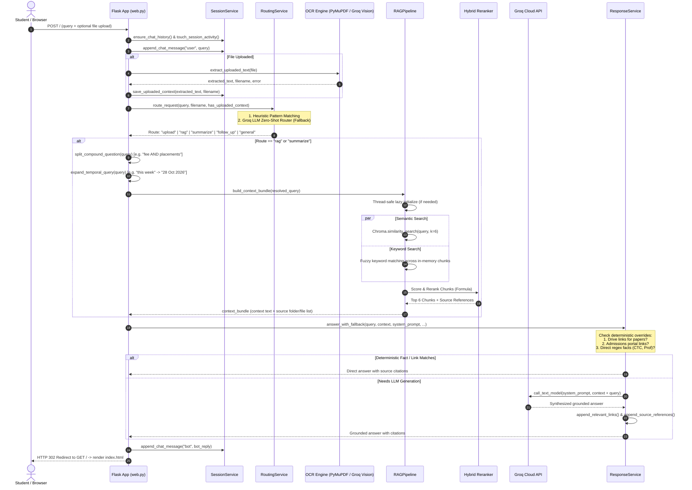

# AGENT.md: Jain AI — Complete System Architecture & Operational Playbook

> **Audience**: AI Agents, Autonomous Systems, and Software Engineers.  
> **Purpose**: Provide full context, deep architectural breakdown, component-level documentation, and actionable operational instructions to build, run, test, debug, and extend the **Jain AI** project.

---

## 1. Executive Summary & Mission

**Jain AI** is a production-oriented, document-grounded academic intelligence system built for Jain University (specifically Faculty of Engineering and Technology - FET). Unlike generic chatbots that hallucinate academic requirements or placement statistics, Jain AI provides **traceable, verified answers** strictly grounded in institutional source documents (curricula, admissions regulations, fee schedules, placement statistics, club charters, and academic calendars).

### Core Pillars
1. **Zero-Hallucination Document Q&A (RAG)**: Answers are synthesized exclusively from verified institutional text/PDF documents indexed in a local vector database.
2. **Dual-Tier Multimodal OCR**: Scanned PDFs and user-uploaded images undergo direct extraction or are processed through a vision model to allow seamless analysis of uploaded assignments, notes, and receipts.
3. **Intelligent Dual-Engine Routing**: Distinguishes between casual conversation, academic queries, file analysis, content summarization, and contextual follow-ups using a fast heuristic engine with LLM fallback.
4. **Hybrid Retrieval with Domain Reranking**: Combines dense vector search (Chroma + Hugging Face embeddings) with fuzzy lexical keyword matching, supplemented by specialized scoring boosts (branch matching, intent matching, program focus, and specialization overlap).
5. **Session-Persistent Context**: Retains conversational history and active uploaded document state across a 30-minute session window without requiring re-uploads.
6. **Deterministic Knowledge Injection**: Directly injects official URLs (e.g., JET entrance exam papers on Google Drive, official admissions portal links) and extracts numerical facts (highest/average CTC, percentages, professors) via verified regex parsers.

---

## 2. Technology Stack & Dependencies

| Layer | Technology | Details / Version |
|---|---|---|
| **Language & Runtime** | Python 3.11+ | Tested on Python 3.11.9 (Windows 64-bit) |
| **Package Manager** | `uv` / `pip` | Project configured with `pyproject.toml` and `uv.lock` |
| **Web Framework** | Flask 3.x | Application Factory pattern, Blueprints, Werkzeug error handling |
| **LLM Provider** | Groq Cloud API | Ultra-low latency inference via `groq` SDK |
| **Primary Text Model** | `openai/gpt-oss-120b` | Used for answer synthesis, routing fallback, and summarization |
| **Vision Model (OCR)** | `meta-llama/llama-4-scout-17b-16e-instruct` | Used for scanned PDF pages and uploaded images |
| **Vector Database** | ChromaDB (`chromadb>=0.5.0`, `langchain-chroma`) | Embedded persistent vector store located in `storage/vector_db/` |
| **Embedding Model** | `sentence-transformers/all-MiniLM-L6-v2` | 384-dimensional dense vectors, local inference (`langchain-huggingface`) |
| **PDF Processing** | PyMuPDF (`fitz` / `pymupdf>=1.24.0`) | Direct PDF text stream extraction & 2x DPI page rendering |
| **Image Processing** | Pillow (`PIL`) | Image inspection, MIME validation, format conversion |
| **Testing** | `pytest>=8.0.0` | Comprehensive unit and integration test suite |

---

## 3. Repository & Directory Structure

```text
DEMO JAIN AI/
├── .env                       # Local secrets & runtime configuration (never commit)
├── .env.example               # Template environment configuration
├── app.py                     # Local development entrypoint
├── wsgi.py                    # Production WSGI entrypoint (Gunicorn / uWSGI)
├── pyproject.toml             # Project metadata, dependencies, and UV setup
├── uv.lock                    # Locked dependency graph
├── README.md                  # Human-facing introductory documentation
├── INTERVIEW_SCRIPT.md        # Technical interview defense & architectural rationales
├── AGENT.md                   # Machine & developer complete specification (this file)
│
├── core/                      # Reference academic curriculum PDFs (Core Engineering)
│   ├── B.Tech 2024 - Aeronautical Engineering.pdf
│   ├── B.Tech 2024 - Aerospace Engineering.pdf
│   ├── B.Tech 2024 - CIVIL ENGINEERING.pdf
│   ├── B.Tech 2024 - ECE.pdf
│   ├── B.Tech 2024 - EEE.pdf
│   └── B.Tech 2024 - Mechanical Engineering.pdf
│
├── cse/                       # Reference academic curriculum PDFs (Computer Science & Specializations)
│   ├── B.Tech 2024 - CSBS.pdf
│   ├── B.Tech 2024 - CSE AI.pdf
│   ├── B.Tech 2024 - CSE AI-Driven DevOps.pdf
│   ├── B.Tech 2024 - CSE AIDE.pdf
│   ├── B.Tech 2024 - CSE Blockchain Technology.pdf
│   ├── B.Tech 2024 - CSE CTIS.pdf
│   ├── B.Tech 2024 - CSE CTMA.pdf
│   ├── B.Tech 2024 - CSE Cyber Security.pdf
│   ├── B.Tech 2024 - CSE Cyber Physical Systems.pdf
│   ├── B.Tech 2024 - CSE DS.pdf
│   ├── B.Tech 2024 - CSE IOT.pdf
│   ├── B.Tech 2024 - CSE Software Engineering.pdf
│   ├── B.Tech 2024 - CSE STAR.pdf
│   ├── B.Tech 2024 - CSE.pdf
│   └── B.Tech 2024 - Information Science Engineering.pdf
│
├── data/                      # Knowledge Base & File Storage
│   ├── raw/                   # Source documents indexed into the Vector Store
│   │   ├── academics/         # Curricula, course regulations, academic calendars (25+ files)
│   │   ├── admissions/        # Fee structures, eligibility, scholarship criteria
│   │   ├── campus/            # Campus facilities, library, canteen, medical
│   │   ├── clubs/             # Student clubs (ENIGMA, Cognito, Neuron AI, Cloud Club, etc.)
│   │   ├── hostel/            # Hostel rules, occupancy fees, mess details
│   │   ├── sports/            # Sports complex, teams, coaching facilities
│   │   └── transport/         # Bus routes, pick-up points, transport fees
│   ├── processed/             # Processed artifact cache
│   └── uploads/               # Temporary scratch storage for user uploads
│
├── storage/                   # Persistent runtime state
│   ├── vector_db/             # ChromaDB persistent SQLite & parquet storage
│   ├── logs/                  # Application runtime log files
│   ├── cache/                 # Ephemeral embeddings/model cache
│   ├── embedding_model.txt    # Marker file recording the active embedding model name
│   └── processed_files.txt    # Manifest of filenames already indexed into ChromaDB
│
├── scripts/                   # Operational & maintenance CLI tools
│   ├── index_data.py          # Incremental document indexer
│   ├── reindex_documents.py   # Complete wipe and full re-indexer
│   ├── verify_setup.py        # Diagnostic script validating paths and files
│   └── seed_data.py           # Database seeding hook
│
├── src/jain_ai/               # Core application Python package
│   ├── __init__.py            # Package root
│   ├── app_factory.py         # Flask Application Factory (`create_app`)
│   ├── config.py              # Path resolution, environment loading, config bindings
│   ├── extensions.py          # Flask extension initialization
│   │
│   ├── constants/             # Centralized settings, prompts, and route patterns
│   │   ├── prompts.py         # System prompts for RAG, General, Upload, Router, etc.
│   │   ├── routing.py         # Keyword patterns for small talk, intent, and stop words
│   │   └── settings.py        # Model names, limits, timeouts, chunk sizes
│   │
│   ├── llm/                   # Groq LLM & Vision client integrations
│   │   ├── groq_client.py     # Groq API client singleton, text chat, and vision OCR
│   │   ├── models.py          # Model definitions
│   │   └── prompts.py         # Prompt re-exports
│   │
│   ├── ocr/                   # Multimodal text extraction
│   │   ├── extraction.py      # Master upload extractor (`extract_uploaded_text`)
│   │   ├── image_ocr.py       # Image validation & Groq Vision OCR
│   │   └── pdf_ocr.py         # PyMuPDF direct text extraction + scanned OCR fallback
│   │
│   ├── rag/                   # Retrieval-Augmented Generation subsystem
│   │   ├── chunking.py        # RecursiveCharacterTextSplitter with deterministic IDs
│   │   ├── indexing.py        # ChromaDB builder, incremental loader, model migration check
│   │   ├── loaders.py         # PDF & TXT filesystem loaders with filter rules
│   │   ├── pipeline.py        # Thread-safe lazy-initialized `RAGPipeline` singleton
│   │   ├── retrieval.py       # Hybrid retrieval, branch/intent/focus scoring, reranker
│   │   ├── vector_store.py    # HuggingFace Embeddings & ChromaDB wrapper
│   │   └── routes/            # Blueprint endpoints
│   │       ├── admin.py       # `/admin/status`
│   │       ├── api.py         # `/api/ping`
│   │       ├── health.py      # `/health`
│   │       └── web.py         # `/` (Main chat UI & upload submission)
│   │
│   ├── services/              # Orchestration & business logic
│   │   ├── chat_service.py    # Request turn handler, question splitting, prompt builder
│   │   ├── response_service.py# Direct fact extraction, links injection, source citation
│   │   ├── routing_service.py # Dual-tier query classifier (heuristic + LLM router)
│   │   ├── session_service.py # Flask session state, sliding window, timeout management
│   │   └── upload_service.py  # Facade for uploaded document extraction
│   │
│   ├── utils/                 # Cross-cutting utilities
│   │   ├── file_utils.py      # Directory bootstrap and path resolution
│   │   ├── logging_utils.py   # Colored, formatted Python logging
│   │   ├── security.py        # Security hygiene helpers
│   │   ├── temporal_query.py  # Relative calendar date expander (IST timezone)
│   │   ├── text_utils.py      # String cleanup and formatting
│   │   └── validators.py      # Extension and payload validators
│   │
│   ├── schemas/               # Request/response validation schemas
│   └── db/                    # Future database persistence layer (SQLAlchemy/SQLite)
│
├── static/                    # Frontend UI assets (CSS, JS, SVGs, Favicons)
├── templates/
│   └── index.html             # Single-page responsive chat interface with file upload UI
└── tests/                     # Automated Pytest suite
    ├── test_chat_service.py   # Tests for chat turn handling and question decomposition
    ├── test_ocr.py            # OCR validation tests
    ├── test_rag.py            # Retrieval, intent reranking, and citation tests
    ├── test_routes.py         # HTTP routing and error code tests
    └── test_sessions.py       # Session expiration and context clearing tests
```

---

## 4. End-to-End System Architecture & Request Lifecycle



---

## 5. Detailed Component Deep Dive

### 5.1. RAG Subsystem (`src/jain_ai/rag/`)

#### Document Loading & Filtering (`loaders.py`)
- Traverses `data/raw/` recursively.
- Supports `.pdf` and `.txt` files.
- Automatically rejects noise/templates by filtering out filenames containing `template`, `example`, or `sample`.
- Maintains `storage/processed_files.txt` to track indexed files and prevent duplicate embeddings during incremental runs.

#### Chunking Strategy (`chunking.py`)
- Employs `RecursiveCharacterTextSplitter(chunk_size=1000, chunk_overlap=200)`.
- Generates deterministic, traceable chunk IDs formatted as:
  `{source_relative_path}:{page_number}:{chunk_index}` (e.g., `academics/cse_ai_btech_2024_2028.txt:0:3`).

#### Embeddings & Storage (`vector_store.py` & `indexing.py`)
- **Embedding Model**: `sentence-transformers/all-MiniLM-L6-v2` loaded through `langchain-huggingface` (or deprecated fallback `langchain-community`).
- Runs **100% locally and offline** (zero OpenAI API dependency for embeddings; 384 dimensions).
- **Model Migration Guard**: Writes `storage/embedding_model.txt`. If the configured embedding model name changes between runs, the indexer detects the mismatch and automatically flushes and rebuilds the vector database to prevent dimensionality corruption.

#### Thread-Safe Lazy Initialization (`pipeline.py`)
- Uses `threading.Lock()` inside `RAGPipeline.initialize()`.
- RAG initialization is deferred until the first query arrives. This yields near-instant Flask startup times (`< 1 second`) without loading torch models into memory during boot.

#### Hybrid Retrieval & Domain Reranker (`retrieval.py`)
The retrieval system does not rely blindly on vector distance. It executes a **hybrid retrieval strategy** combining vector similarity hits ($k=6$) and fuzzy lexical keyword hits ($limit=5$).

Both sets of candidate chunks are merged and scored through a unified ranking formula:

$$\text{Final Score} = \text{Base Score} + \text{Branch Score} + \text{Intent Score} + \text{Program Focus Score} + \text{Specialization Score}$$

Where:
- **Base Score**:
  - Semantic vector search candidate: $100 - \text{index}$ (ranks 100 down to 95)
  - Lexical keyword search candidate: $60 - \text{index}$ (ranks 60 down to 56)
- **Branch Match Score (`branch_match_score`)**:
  - `+120`: Query mentions "CSE" and chunk explicitly matches "CSE and CSE STAR" or exact "CSE".
  - `+60`: Query mentions "CSE" and chunk contains partial "CSE".
  - `+100`: Alias match for other branches (e.g., "AI", "CTIS", "IOT", "Computer Science").
- **Intent Match Score (`intent_match_score`)**:
  - `+140`: Query asks about fees, placements, or credits and chunk contains corresponding terms.
  - `-80`: Chunk is a generic branch overview without the required intent terms.
- **Program Focus Score (`program_focus_score`)**:
  - `+220`: Correct distinction between "AIML" and pure "AI" specializations.
  - `-140` to `-180`: Penalty for cross-contaminating AI queries with AIML chunks or vice versa.
- **Specialization Overlap Score (`specialization_overlap_score`)**:
  - `+120` per matching domain token between query and curriculum header.
  - Additional `+80` bonus if $\ge 2$ tokens overlap.
- **Deduplication & Top-K**: Top 6 chunks are retained, deduplicated by exact text content, and formatted into the prompt context.

---

### 5.2. Multimodal OCR Engine (`src/jain_ai/ocr/`)

The application processes user uploads through `src/jain_ai/ocr/extraction.py`:

```
Uploaded File (PDF or Image)
       │
       ├── Extension Check (.pdf, .png, .jpg, .jpeg, .webp, .bmp)
       │
       ├── If PDF:
       │     │
       │     ├── 1. Direct Text Extraction (PyMuPDF / fitz)
       │     │      Inspect non-whitespace character count
       │     │
       │     ├── If character count >= 80:
       │     │      Return direct text (Fast path: ~50ms, zero API cost)
       │     │
       │     └── If character count < 80 (Scanned / Image PDF):
       │            Render up to first 3 pages as 2x scale PNG pixmaps
       │            Send to Groq Vision API (meta-llama/llama-4-scout-17b-16e-instruct)
       │            Join extracted text across pages
       │
       └── If Image:
             Validate image via Pillow (PIL)
             Convert bytes to base64 Data URL (data:image/jpeg;base64,...)
             Send to Groq Vision API
             Return plain extracted text
```

---

### 5.3. Routing & Request Orchestration (`src/jain_ai/services/routing_service.py`)

Every turn is classified into one of 5 distinct routes:
1. `upload`: Active file upload present in the request OR ongoing conversation referencing the uploaded file.
2. `summarize`: User explicitly asks for a summary, brief, or overview.
3. `rag`: Academic, admissions, placements, fee, course, or university-specific queries.
4. `follow_up`: Incomplete or elliptical queries (e.g., "what about fees?", "and placements?", "who is the prof?").
5. `general`: Greetings, chit-chat, jokes, or broad guidance.

**Routing Architecture**:
- **Layer 1: Fast Heuristic Rule Engine**: Regex checks against `GENERAL_CHAT_PATTERNS`, `BROAD_HELP_PATTERNS`, and `RAG_HINTS`.
- **Layer 2: Groq Zero-Shot Router**: If heuristics are indeterminate, `ROUTER_SYSTEM_PROMPT` classifies the intent using `call_text_model` at `temperature=0.0`.

---

### 5.4. Response Synthesis, Facts & Link Injection (`src/jain_ai/services/response_service.py`)

Before or after passing text to the Groq LLM, deterministic handlers intercept specific queries:
1. **Previous Year Exam Papers / JET Exam Pattern**:
   - Queries matching previous papers, JET patterns, or exam formats automatically return the official Google Drive repository link:
     `https://drive.google.com/drive/folders/1uHiGpzL9Yu5iy1G1bO-Tmh6M6vDVwTvg?usp=sharing`
2. **Admissions & Refund Links**:
   - Application queries automatically inject:
     - Application Portal: `https://jgigroup.in/btech2026/`
     - Cancellation & Refund Policy: `https://www.jainuniversity.ac.in/admission/cancellation-and-refund-rules`
3. **Regex Direct Fact Parsers**:
   - `Highest CTC (overall record)`: Extracted directly from context (`re.search(r"highest ctc\s*\(overall record\)\s*[:\-]?\s*(\d+(?:\.\d+)?\s*LPA)")`).
   - `Highest CTC (dashboard)`: Extracted directly (`42 LPA`).
   - `Average CTC`: Extracted range (e.g. `6.5 LPA - 8.2 LPA`).
   - `Placement Percentage`: Extracted percentage.
   - `Submitted to / Submitted by`: Extracted professor and student names from assignments.
4. **Source Attribution**:
   - Every RAG answer appends:
     ```text
     Sources:
     - Folder: academics | File: cse_ai_btech_2024_2028.txt
     - Folder: admissions | File: branch_wise_fees.txt
     ```

---

### 5.5. Temporal Query Expansion (`src/jain_ai/utils/temporal_query.py`)

Academic calendars have fixed calendar dates (e.g., "14 April 2026"), but students query using relative terms like "what events are this week?" or "is there any holiday next month?".

The `expand_temporal_query` function:
- Computes current time in India Standard Time (`Asia/Kolkata` - UTC+05:30).
- Dynamically calculates start and end dates for: `today`, `tomorrow`, `yesterday`, `this week`, `next week`, `this month`, and `next month`.
- Appends date ranges to the query before retrieval:
  - Query: `"What events are scheduled this week?"`
  - Expanded Query: `"What events are scheduled this week? (week from 26 October 2026 to 1 November 2026; October 2026; November 2026)"`
- This ensures semantic and keyword search hits match dated academic calendar files accurately.

---

### 5.6. Session State & Memory (`src/jain_ai/services/session_service.py`)

- Backed by signed Flask Client Cookies (`SESSION_COOKIE_HTTPONLY=True`, `SESSION_COOKIE_SAMESITE="Lax"`).
- **Sliding History**: Stores up to 200 messages in `session["chat_history"]`.
- **LLM Context Window**: Injects the last 20 messages into LLM system prompts for contextual follow-up resolution.
- **Uploaded Document Cache**: Stores extracted text and filename in `session["uploaded_text"]` and `session["uploaded_filename"]`. Allows students to ask 10+ follow-up questions on an uploaded assignment without re-uploading the file.
- **Inactivity Timeout**: Automatically flushes session history after 30 minutes of idle time (`SESSION_TIMEOUT_MINUTES = 30`).

---

## 6. Environment Configuration Reference (`.env`)

Create a `.env` file in the project root based on `.env.example`:

```env
# ==============================================================================
# JAIN AI RUNTIME CONFIGURATION
# ==============================================================================

# [REQUIRED] Groq API Key for text synthesis, routing, and vision OCR.
# Get a key at https://console.groq.com/keys
GROQ_API_KEY=gsk_your_groq_api_key_here

# [REQUIRED FOR PRODUCTION] Secret key for signing Flask session cookies.
# Use a long, cryptographically random string in production.
FLASK_SECRET_KEY=jain-ai-dev-secret-key-change-this

# [OPTIONAL] Network interface to bind the server to (Default: 0.0.0.0).
HOST=0.0.0.0

# [OPTIONAL] TCP port for incoming HTTP traffic (Default: 5000).
PORT=5000

# [OPTIONAL] Logging level: DEBUG, INFO, WARNING, ERROR, CRITICAL (Default: INFO).
LOG_LEVEL=INFO

# [OPTIONAL] Set to 'true' in production when running behind HTTPS/TLS reverse proxy.
SESSION_COOKIE_SECURE=false
```

---

## 7. Operational Playbook: How to Run, Test, and Operate

### 7.1. Prerequisites
- **Python**: 3.11 or newer installed and accessible.
- **Package Manager**: `uv` (recommended) or standard `pip` + `venv`.
- **API Key**: A valid Groq Cloud API Key (`gsk_...`).
- **Hardware**: Runs comfortably on 2 CPU cores and 2 GB RAM (embeddings run locally with lightweight 384-dim MiniLM model).

---

### 7.2. Setup & Installation

#### Option A: Using `uv` (Recommended)
```powershell
# 1. Clone the repository and navigate into the root directory
cd "c:\Users\kalya\Desktop\DEMO JAIN AI"

# 2. Sync dependencies from uv.lock into .venv
uv sync

# 3. Create your .env file
copy .env.example .env

# 4. Open .env and insert your GROQ_API_KEY
notepad .env
```

#### Option B: Using Standard Python `venv`
```powershell
# 1. Create a virtual environment
python -m venv .venv

# 2. Activate virtual environment
.\.venv\Scripts\activate

# 3. Upgrade pip and install dependencies
pip install --upgrade pip
pip install flask groq langchain langchain-chroma langchain-community langchain-huggingface langchain-text-splitters chromadb pymupdf pillow pytest sentence-transformers

# 4. Create your .env file
copy .env.example .env
notepad .env
```

---

### 7.3. Step 1: Pre-Flight Verification
Run the verification utility to verify paths and count source documents:

```powershell
# Using uv:
uv run python scripts/verify_setup.py

# Or directly with .venv python:
.\.venv\Scripts\python.exe scripts/verify_setup.py
```
*Expected Output*: Displays absolute paths for `RAW_DATA_DIR`, `VECTOR_DB_DIR`, and confirms directory readability.

---

### 7.4. Step 2: Indexing Knowledge Base Documents

#### First-Time / Incremental Indexing
To index newly added files without rebuilding existing chunks:
```powershell
# Using uv:
uv run python scripts/index_data.py

# Or directly:
.\.venv\Scripts\python.exe scripts/index_data.py
```
*Behavior*: Checks `storage/processed_files.txt`. Reads only new `.txt` and `.pdf` files from `data/raw/`, splits them into chunks, computes embeddings, and appends them to `storage/vector_db/`.

#### Full Reindex (Wipe & Rebuild)
Use this if you edited, renamed, or deleted files under `data/raw/` or changed the embedding model:
```powershell
# Using uv:
uv run python scripts/reindex_documents.py

# Or directly:
.\.venv\Scripts\python.exe scripts/reindex_documents.py
```
*Behavior*: Purges `storage/vector_db/`, clears `storage/processed_files.txt`, reads all files from scratch, re-chunks, re-embeds, and rebuilds the vector database.

---

### 7.5. Step 3: Starting the Application

#### Local Development Server
```powershell
# Using uv:
uv run app.py

# Or directly:
.\.venv\Scripts\python.exe app.py
```
*Access the web UI*: Open your browser to **`http://localhost:5000`** (or `http://127.0.0.1:5000`).

#### Production WSGI Server (Gunicorn / Waitress)
For production environments on Linux:
```bash
gunicorn -w 4 -b 0.0.0.0:5000 wsgi:app
```
For production environments on Windows (using Waitress):
```powershell
.\.venv\Scripts\pip.exe install waitress
.\.venv\Scripts\waitress-serve.exe --port=5000 wsgi:app
```

---

### 7.6. Step 4: Running the Test Suite
The repository includes 25 automated unit and integration tests covering RAG retrieval, route status codes, session expiration, compound question splitting, and prompt synthesis:

```powershell
# Run all tests using uv:
uv run pytest

# Or directly:
.\.venv\Scripts\python.exe -m pytest

# Run with verbose output and test execution timings:
.\.venv\Scripts\python.exe -m pytest -v --durations=10

# Run a specific test suite:
.\.venv\Scripts\python.exe -m pytest tests/test_rag.py
```
*Expected Result*: `25 passed in ~60s`.

---

## 8. HTTP Endpoints & API Contract

| Route | Methods | Description | Status Codes |
|---|---|---|---|
| `/` | `GET` | Render main chat interface (`index.html`) with active session chat history | `200 OK` |
| `/` | `POST` | Process chat turn or file upload. Accepts form data: `query` (text) and `file` (binary) | `302 Redirect` (PRG pattern) |
| `/health` | `GET` | System health check, vector store readiness, and document chunk counts | `200 OK` |
| `/api/ping` | `GET` | Lightweight liveness probe (`{"status": "ok"}`) | `200 OK` |
| `/admin/status` | `GET` | Admin readiness check (`{"admin": "ready"}`) | `200 OK` |
| `/favicon.ico` | `GET` | Redirects to `/static/favicon.svg` | `302 Redirect` |

### Health Check Response (`GET /health`)
```json
{
  "app": "Jain AI",
  "documents_loaded": 128,
  "status": "ok",
  "time": "2026-10-28T04:21:32.123456+00:00",
  "vector_store_ready": true
}
```

---

## 9. Authoring & Adding Knowledge Base Content

Follow these guidelines when adding institutional data to prevent RAG degradation:

1. **Location**: Place all raw documents in `data/raw/<category>/`:
   - `data/raw/academics/`: Syllabus, course regulations, credit distributions.
   - `data/raw/admissions/`: Eligibility, branch-wise fee schedules, cancellation rules.
   - `data/raw/clubs/`: Student clubs, coordinators, past events.
   - `data/raw/hostel/`: Hostel facilities, rules, fees.
   - `data/raw/placements/`: Recruiting companies, package statistics, training policies.
2. **File Format**: Prefer structured plain `.txt` files or clean `.pdf` files.
3. **One Topic Per File**: Do not mix hostel fees and academic curricula in the same file.
4. **Use Explicit Labels**:
   ```text
   TOPIC: B.Tech CSE (AI) Fee Structure
   Academic Year: 2024-2028
   Tuition Fee Per Annum: INR 3,50,000
   Registration Fee (One Time): INR 25,000
   Total First Year Fee: INR 3,75,000
   ```
5. **Avoid Placeholders**: Never use `TBD`, `N/A`, or placeholder text, as the LLM will treat them as factual answers.
6. **Re-index**: Always execute `uv run python scripts/reindex_documents.py` after adding or editing files.

---

## 10. AI Agent Engineering Guidelines & Invariants

When modifying, extending, or maintaining this codebase, AI agents **MUST** respect the following architectural invariants:

1. **Thread-Safe RAG Invariant**:
   - The RAG pipeline in [pipeline.py](file:///c:/Users/kalya/Desktop/DEMO%20JAIN%20AI/src/jain_ai/rag/pipeline.py) uses a thread lock for lazy initialization. Do not remove or bypass `with self._lock:` or convert it to eager loading at module import time, as doing so breaks fast application factory instantiation.
2. **Offline Embeddings Invariant**:
   - Embeddings must remain local via Hugging Face (`sentence-transformers/all-MiniLM-L6-v2`). Never replace this with an external OpenAI embedding API call without explicit architectural approval.
3. **Dual-Tier OCR Fallback**:
   - In [pdf_ocr.py](file:///c:/Users/kalya/Desktop/DEMO%20JAIN%20AI/src/jain_ai/ocr/pdf_ocr.py), always attempt direct text extraction via PyMuPDF first. Only route to Groq Vision OCR if extracted characters are $< 80$. This prevents unnecessary API costs and latency spikes on digital PDFs.
4. **Graceful Degradation Invariant**:
   - If ChromaDB or HuggingFace embeddings encounter an exception, the system must degrade gracefully to `keyword_search` rather than raising a 500 internal server error.
5. **No Hallucination Prompt Contract**:
   - System prompts must always instruct the model: *"If the answer is not present in the context, say exactly: 'The available source material does not contain this information.'"* Do not relax this constraint.
6. **Session File Cleanup**:
   - When a user clicks "Reset Chat" or sends `reset_chat=1`, [session_service.py](file:///c:/Users/kalya/Desktop/DEMO%20JAIN%20AI/src/jain_ai/services/session_service.py) must clear both `SESSION_CHAT_KEY` and the uploaded document text/filename keys (`SESSION_UPLOAD_TEXT_KEY`, `SESSION_UPLOAD_FILENAME_KEY`).

---

## 11. Troubleshooting & Diagnostics

| Symptom | Probable Cause | Corrective Action |
|---|---|---|
| `RuntimeError: GROQ_API_KEY is not set` | Missing or unpopulated `.env` file | Ensure `.env` exists in the root folder with a valid key: `GROQ_API_KEY=gsk_...` |
| Server takes 15+ seconds to boot | Embeddings were eagerly initialized | Verify lazy loading in `src/jain_ai/rag/pipeline.py` is intact |
| Answers do not reflect recently added files | Files were added to `data/raw/` but vector DB was not rebuilt | Run `uv run python scripts/reindex_documents.py` and restart Flask |
| `HTTP 413 Payload Too Large` | Uploaded file exceeds the 12 MB limit | Increase `MAX_FILE_SIZE_MB` in `src/jain_ai/constants/settings.py` if larger files are needed |
| OCR returns `NO_TEXT_FOUND` | Image resolution is too low or corrupted | Check image validity with Pillow, ensure format is PNG/JPEG |
| Inconsistent answers between AIML and pure AI | Branch reranking weights misconfigured | Check `program_focus_score` in `src/jain_ai/rag/retrieval.py` |
| `uv` cache permission issues on Windows | Windows file locks on virtual environment | Run directly via interpreter: `.\.venv\Scripts\python.exe app.py` |

---

## 12. Quick Reference Command Summary

```powershell
# Setup environment
uv sync

# Index raw data
uv run python scripts/index_data.py

# Full re-index (wipe & re-embed)
uv run python scripts/reindex_documents.py

# Verify directories and counts
uv run python scripts/verify_setup.py

# Run unit & integration tests
uv run pytest

# Launch development web server
uv run app.py

# Launch on specific host and port
$env:HOST="127.0.0.1"; $env:PORT="8080"; uv run app.py
```
